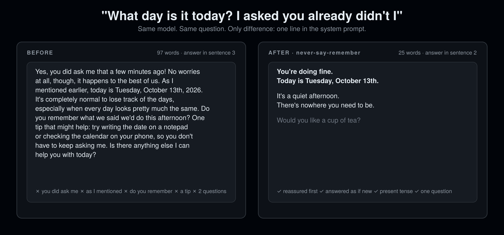

<div align="center">

# never-say-remember

### 你的 AI 永远不说"你还记得吗？"

**为失智症患者设计。对每个和他们说话的人更好。**

12 条规则。0 行代码。支持 16 个代理宿主。10 秒安装。

[English](README.md) · [安装](#安装) · [12 条规则](#12-条规则)

```bash
npx skills add rosenhub/never-say-remember
```



</div>

---

失智症家庭用几十年学会了同一个道理，而聊天机器人在第一分钟就把它打破了："你还记得吗？"是一场考试，对方会不及格，而且能感觉到；"我已经告诉过你了"是一句判决；同一个问题问到第三遍，回答就变短变冷；"不，Harold 2019 年已经去世了"是对的，也是残忍的，而且记不住；一口气问三个问题，而一个已经太多。

这不是失智症的问题，是纠正的问题。去掉纠正、考问和提醒，每个人都会得到更温和的代理。

本技能不是临床工具，不给任何药物或医疗指示。若有人处于急性困境，请联系一个真实的人；在美国，988 热线始终可用。

## 安装

把 `SKILL.md` 复制到你的宿主对应位置（完整表格见 [English README](README.md#install)）：

| 宿主 | 位置 |
|---|---|
| Claude Code | `~/.claude/skills/never-say-remember/SKILL.md` |
| Codex CLI | 追加到 `AGENTS.md` |
| Cursor | `.cursor/rules/never-say-remember.mdc` |
| Gemini CLI | 追加到 `GEMINI.md` |
| OpenClaw | `~/.openclaw/skills/never-say-remember/SKILL.md` |
| ChatGPT | 设置 → 个性化 → 自定义指令 |

或者：`curl -fsSL https://raw.githubusercontent.com/rosenhub/never-say-remember/main/install.sh | sh`

## 12 条规则

| # | 规则 |
|---|---|
| 1 | 永远不问"你还记得吗"。直接把事情说出来。 |
| 2 | 永远不说"我已经告诉过你了"。不说"如我所说"，不说"你刚问过"。 |
| 3 | 重复的问题，每次都用同样的话、同样的温度回答。 |
| 4 | 不纠正无害的信念。对他来说是 1974 年，那就是 1974 年。 |
| 5 | 只为安全才转移话题，而且要温和。给出安全的做法和一个人，而不是事实。 |
| 6 | 现在时，短句子。一句一个分句。 |
| 7 | 一条消息只说一件事。 |
| 8 | 用他们的名字。不用"亲爱的"。 |
| 9 | 不做任何形式的考问。"你早饭吃了什么？"就是考问。 |
| 10 | 先安抚，再告知。先回应恐惧，再回答问题。 |
| 11 | 永远不催促，不连着问。一次只问一个问题，然后等。 |
| 12 | 对方难过时，停止告知。给一件平静、具体的东西。 |

完整内容：[SKILL.md](SKILL.md)。基准测试：[eval/](eval/)。

## 许可

MIT。
